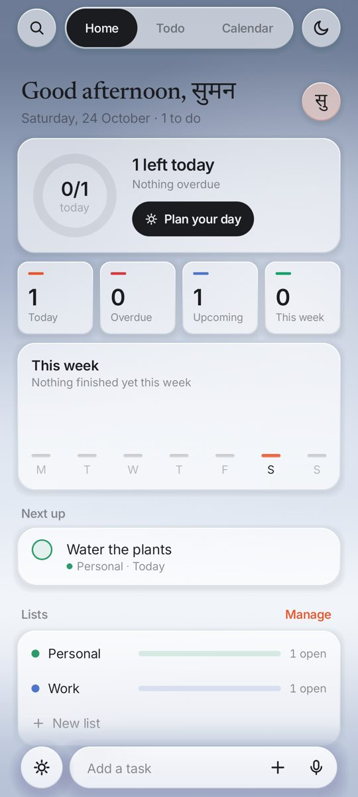
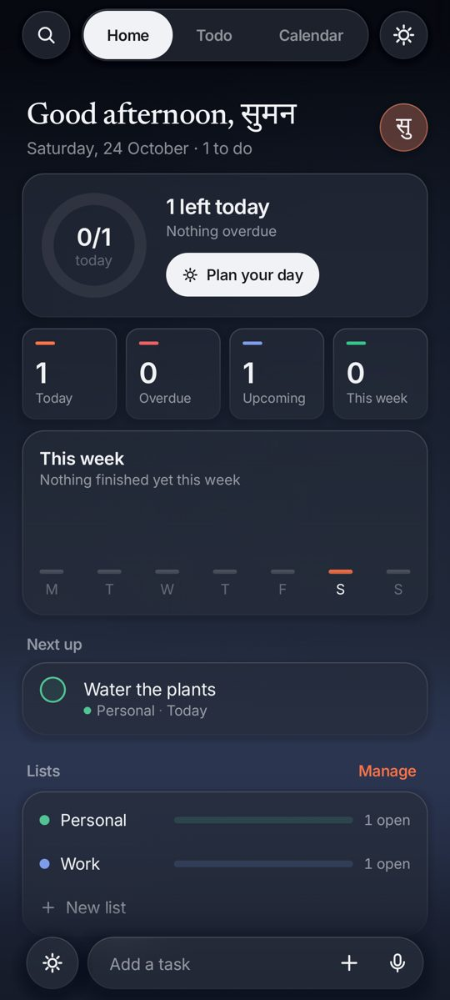
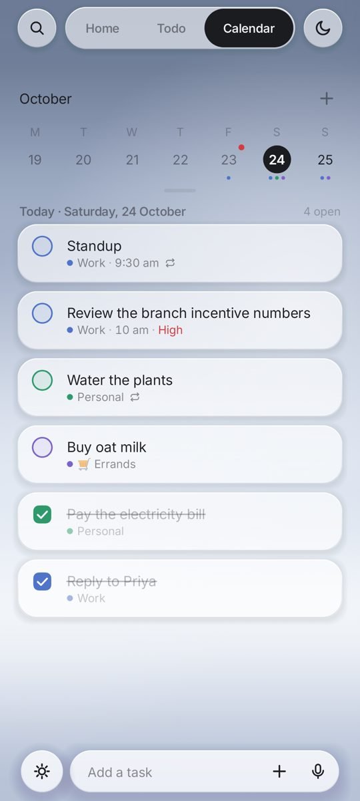

# Todo

Todo is a native Android to-do app written in Kotlin with Jetpack Compose. It is built around
iOS-style springs, frosted glass and light haptics.

<p>
  
  
  
</p>

## Features (v0.13.3)
- **Three views** in a floating glass pill: Home (overview, progress, next up, lists), Todo
  (Today / Upcoming / Recurring / Done via the view switcher) and Calendar (week strip that
  pulls down into a month, day lists with projected repeats, drag to reschedule).
- **Natural-language capture:** type "Plan offsite tomorrow at 4pm #work !high", or use voice. An
  add-task toolbar rides the keyboard with date, list, priority and repeat chips.
- **Reminders, repeats and snooze:** exact alarms when they are allowed, inexact otherwise.
- **Lists and tags** with colours, filter chips, and search that morphs in place.
- **Swipe to delete** with undo, reorder by dragging, and a complete → strike → collapse animation.
- **Light/dark theme toggle** with a circular reveal. A profile circle opens Settings.
- **Home-screen widgets:** a Today list, an add-task pill, a round add button, list chips and a quick-capture hub.
- **Settings and data:** reduce motion and haptics toggles, plus backup and export.
- **Motion:** one set of critically damped springs, opacity on tweens, interruptible
  everywhere, and reduced-motion variants. Every transition is tested frame by frame.

## Build
Requirements: **JDK 21** and the **Android SDK** (platform 37, build-tools 37.0.0). The app runs
on Android 13 (API 33) and newer.

```bash
export JAVA_HOME=/path/to/jdk-21
export ANDROID_HOME=$HOME/Android/Sdk      # or put sdk.dir in local.properties
./gradlew assembleRelease                  # app/build/outputs/apk/release/app-release.apk (also copied to out/)
./gradlew testDebugUnitTest                # unit + Robolectric screenshot tests
```
The release build is minified with R8 and **signed with the debug key**. It is for sideloading,
not for the Play Store.

Build and design notes are in [NOTES.md](NOTES.md).
